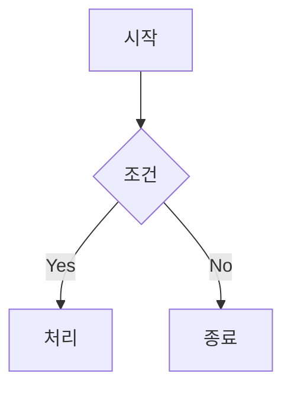

# Markdown 문법(Syntax) 완전 정리 가이드

> **대상**: 코딩을 처음 배우는 분부터 기술 면접·프로젝트 운영을 준비하는 분까지  
> **기준 문서**: `README.md` (마크다운 기본 예제 모음)  
> **산출물**: 이 문서(`syntax.md`)는 마크다운(Markdown) 문법을 **개념 → 기본 문법 → 고급 문법 → 실전 적용 → 트러블슈팅 → 면접 대비** 순서로 정리한 참고서입니다.

---

## 0. 이 문서를 읽는 법

- **코드 블록(``` `)` 안의 내용은 "입력(마크다운 원문)"**입니다.
- 코드 블록 아래의 렌더링 예시는 "브라우저/GitHub에서 보이는 결과"입니다.
- 모든 예제는 **GitHub Flavored Markdown(GFM)**을 기본으로 하되, 플랫폼별 차이가 있는 경우 따로 표시합니다.
- 초보자는 1~9장을 먼저, 면접/운영 준비는 16~21장을 추가로 읽으세요.

---

## 1. 목차

1. [마크다운이란?](#2-마크다운이란)
2. [README.md 분석: 기본 구조 읽기](#3-readmemd-분석-기본-구조-읽기)
3. [파일/확장자/렌더링 환경](#4-파일확장자렌더링-환경)
4. [핵심 작성 규칙 (라인·공백·들여쓰기)](#5-핵심-작성-규칙)
5. [제목 (Heading)](#6-제목-heading)
6. [문단·줄바꿈·수평선](#7-문단줄바꿈수평선)
7. [강조 (Bold/Italic/Code)](#8-강조-bolditaliccode)
8. [인용 (Blockquote)](#9-인용-blockquote)
9. [목록 (List)](#10-목록-list)
10. [코드 (Inline/Fenced)](#11-코드-inlinefenced)
11. [링크 (Link)](#12-링크-link)
12. [이미지 (Image)](#13-이미지-image)
13. [표 (Table)](#14-표-table)
14. [HTML 삽입](#15-html-삽입)
15. [GitHub Flavored Markdown (GFM) 추가 문법](#16-github-flavored-markdown-gfm)
16. [고급/확장 문법 (Mermaid, 수식, 뱃지, TOC)](#17-고급확장-문법)
17. [플랫폼별 차이](#18-플랫폼별-차이)
18. [트러블슈팅 (문제 해결)](#19-트러블슈팅-문제-해결)
19. [응용 케이스 (실전 예제)](#20-응용-케이스-실전-예제)
20. [기술 면접 Q&A](#21-기술-면접-qa)
21. [베스트 프랙티스 & 체크리스트](#22-베스트-프랙티스--체크리스트)
22. [치트시트 (한 페이지 요약)](#23-치트시트-한-페이지-요약)
23. [참고 자료](#24-참고-자료)

---

## 2. 마크다운이란?

**Markdown**은 2004년 John Gruber가 만든 **경량 마크업 언어(Lightweight Markup Language)**입니다.  
"읽기 쉬운 평문(plain text)을 그대로 쓰되, 최소한의 기호로 구조(제목·목록·강조 등)를 표현"하는 것이 목표입니다.

### 2.1 왜 마크다운을 쓰는가

- **가독성**: 원문 자체가 읽기 쉽습니다. HTML 태그보다 훨씬 덜 복잡합니다.
- **이식성**: `.md` 파일은 어디서나 열 수 있습니다(메모장, VS Code, GitHub 등).
- **버전 관리 친화**: Git으로 diff/merge가 깔끔합니다(텍스트이므로).
- **문서화 표준**: README, CHANGELOG, 이슈/PR, 위키, 블로그의 사실상 표준입니다.
- **도구 생태계**: Pandoc, MkDocs, Docusaurus, Jupyter 등 변환/렌더링 도구가 풍부합니다.

### 2.2 마크다운 vs HTML vs 기타 마크업

| 항목 | Markdown | HTML | reStructuredText | AsciiDoc |
|---|---|---|---|---|
| 학습 난이도 | 매우 쉬움 | 보통 | 보통 | 보통 |
| 가독성 | 높음 | 낮음(태그) | 높음 | 높음 |
| 확장성 | 제한적(GFM 확장) | 무제한 | 강함 | 매우 강함 |
| 문서 사이트 | MkDocs/Docusaurus | 직접 | Sphinx | Antora |
| Git diff | 좋음 | 보통 | 좋음 | 좋음 |

**면접 포인트**: "마크다운은 구조를 표현하는 최소 문법이고, 필요 시 HTML로 보완한다."

---

## 3. README.md 분석: 기본 구조 읽기

`README.md`는 프로젝트의 첫인상(landing page)입니다. 함께 봅시다.

원문(요약)과 의미:

```markdown
headline, heading
h1 ~ h6
# 제목1
## 제목2
### 제목3
#### 제목4
##### 제목5
###### 제목6
```

- 줄: `headline, heading`와 `h1 ~ h6`는 그냥 **문단 텍스트**입니다.
- `# 제목1` … `###### 제목6`는 **Heading(제목) 레벨 1~6**입니다.

```markdown
안녕하세요
안녕하세요


안녕하세요

스페이스 두 개
```

- **빈 줄 한 칸**으로 문단(paragraph)을 구분합니다.
- 빈 줄이 없으면 줄바꿈이 무시되고 한 문단으로 합쳐질 수 있습니다.
- "스페이스 두 개" 뒤에 실제로 스페이스 2개를 넣으면 **강제 줄바꿈(line break)**이 됩니다.

```markdown
안녕하세요<br>
반갑습니다 ~~ 하하하~~
```

- `<br>`은 HTML 줄바꿈 태그로 강제 줄바꿈을 만듭니다.
- `~~ ... ~~`는 취소선(strikethrough)입니다. (GFM)

```markdown
<center>가운데 정렬


**강조** *기울기*
***강조기울기*** </center>
```

- `<center>`는 HTML 정렬 태그(일부 플랫폼 지원)로 가운데 정렬을 줍니다.
- `**...**` 굵게, `*...*` 기울임, `***...***` 굵게+기울임.

```markdown
<strong>안녕하세요.
ㅁㄴㅇㄹ
ㅁㄴㅇㄻㄴㅇㄹ</strong>
```

- `<strong>` HTML 태그로 강조(굵게)합니다. 마크다운 `**`와 결과는 같지만 태그 방식입니다.

**배운 점**: 마크다운은 "마크다운 문법 + HTML"이 섞여도 됩니다. 이 유연성이 실무에서 자주 쓰입니다.

---

## 4. 파일·확장자·렌더링 환경

- **확장자**: `.md`, `.markdown`, `.mkd` (주로 `.md`)
- **렌더러**: CommonMark/GFM 구현체(예: GitHub, GitLab, VS Code 미리보기, Obsidian, Notion import 등)
- **인코딩**: UTF-8 권장(한글/이모지 안전)
- **줄바꿈**: LF 권장(Windows CRLF도 동작하지만 diff 잡음 발생)
- **파일명**: `README.md`(대문자 README)는 GitHub가 자동으로 프로젝트 첫 페이지에 렌더링

---

## 5. 핵심 작성 규칙

### 5.1 빈 줄(Blank line)의 역할

마크다운은 블록 요소(제목, 문단, 목록, 코드블록 등) 사이에 **빈 줄 1개**가 필요합니다. 없으면 한 문단으로 합쳐지거나 렌더링이 깨집니다.

```markdown
# 제목

첫 번째 문단입니다.

두 번째 문단입니다.
```

### 5.2 들여쓰기 (Indentation)

- 목록의 하위 항목은 보통 **공백 2~4개** 또는 **탭 1개**로 들여씁니다(GitHub는 2칸도 인식).
- 코드 블록 안 들여쓰기는 블록 내부에서 그대로 유지됩니다.

### 5.3 이스케이프 (Escaping)

특수 문자를 그대로 보이게 하려면 백슬래시 `\`를 앞에 붙입니다.

```markdown
\# 이것은 제목이 아닙니다
\*별표 그대로\*
\[링크\](url)
\\
```

결과: `# 이것은 제목이 아닙니다`, `*별표 그대로*`, `[링크](url)`, `\`

### 5.4 HTML 엔티티

```markdown
&lt; &gt; &amp; &quot; &nbsp;
```

결과: < > & " (공백)

### 5.5 주석(Comment)

표준 마크다운에는 주석 문법이 없지만, HTML 주석을 사용합니다.

```markdown
<!-- 이것은 주석입니다. 렌더링되지 않습니다. -->
```

---

## 6. 제목 (Heading)

### 6.1 ATX 스타일 (권장)

```markdown
# 제목 1 (h1)
## 제목 2 (h2)
### 제목 3 (h3)
#### 제목 4 (h4)
##### 제목 5 (h5)
###### 제목 6 (h6)
```

Rules:
- `#` 개수 = 레벨(1~6)
- `#` 뒤에 **공백 1개** 필수 (`#제목`은 브라우저에 따라 안 됨)
- 한 줄에 하나의 제목

### 6.2 Setext 스타일 (구식, h1/h2만)

```markdown
제목 1
======

제목 2
------
```

- `=`는 h1, `-`는 h2입니다.
- 현재는 ATX가 표준이므로 ATX를 사용하세요.

### 6.3 제목 사용 원칙 (운영/면접용)

- **h1은 문서에 1개** (페이지 제목)
- **계층 건너뛰지 않기**: h1 → h3 (X), h1 → h2 → h3 (O)
- **제목만으로 TOC 생성**: GitHub는 `#` 기반으로 자동 anchor를 만듭니다.
- anchor 슬러그: 소문자, 공백→`-`, 특수문자 제거 (한글은 유지되는 경우도 있음 → 영문 kebab-case 권장)

면접 Q: "왜 h1 하나만 쓰는가?" → 접근성/SEO/TOC 일관성/문서 구조 명확화.

---

## 7. 문단·줄바꿈·수평선

### 7.1 문단 (Paragraph)

```markdown
첫 번째 문단의 첫 줄입니다.
같은 문단 안에서 줄바꿈 없이 이어집니다.

빈 줄로 분리된 두 번째 문단.
```

- **빈 줄**이 문단 구분자입니다.
- 같은 문단 내 개행은 공백으로 처리되어 한 줄로 보입니다.

### 7.2 강제 줄바꿈 (Line Break)

방법 1: 줄 끝에 공백 2개 + Enter (보이지 않으므로 위험)

```markdown
첫 줄  (← 여기 공백 2개)
둘째 줄
```

방법 2: `<br>` 태그 (명확, 권장)

```markdown
첫 줄<br>
둘째 줄
```

### 7.3 수평선 (Horizontal Rule)

```markdown
---
***
___
```

- 세 개 이상의 `-`, `*`, `_`를 한 줄에 작성.
- `---` 아래에 빈 줄 없이 텍스트가 바로 오면 **제목(Setext h2)**으로 해석되니 주의!

트러블슈팅: `제목\n---`처럼 쓰면 h2가 됩니다. 구분선 의도라면 위아래 빈 줄을 넣으세요.

---

## 8. 강조 (Bold/Italic/Code)

### 8.1 굵게 (Bold)

```markdown
**굵은 글씨**
__굵은 글씨__
```

### 8.2 기울임 (Italic)

```markdown
*기울인 글씨*
_기울인 글씨_
```

### 8.3 굵게+기울임

```markdown
***굵고 기울임***
___굵고 기울임___
**_굵고 기울임_**
```

### 8.4 취소선 (Strikethrough, GFM)

```markdown
~~삭제된 내용~~
```

### 8.5 인라인 코드 (Inline Code)

```markdown
`printf()` 함수를 사용하세요.
```

- 코드 안에서 백틱 `` ` ``을 쓰려면 더블 백틱으로 감쌉니다:

```markdown
`` here is a backtick ` ``
```

### 8.6 밑줄/형광펜 (HTML로 보완)

마크다운 표준엔 밑줄이 없습니다. HTML `<u>`, `<mark>` 사용:

```markdown
<u>밑줄</u>  
<mark>형광펜</mark>
```

---

## 9. 인용 (Blockquote)

### 9.1 기본 인용

```markdown
> 이것은 인용문입니다.
> 여러 줄에 걸쳐 쓸 수 있습니다.
```

### 9.2 중첩 인용

```markdown
> 첫 번째 레벨
>> 두 번째 레벨
>>> 세 번째 레벨
```

### 9.3 인용 안의 다른 요소

```markdown
> **제목**: 인용 안에서도
>
> - 목록
> - 가능
>
> ```python
> print("code in quote")
> ```
```

Tip: 인용 블록 사이 빈 줄에 `>` 를 넣어야 연속 인용으로 유지됩니다.

---

## 10. 목록 (List)

### 10.1 순서 없는 목록 (Unordered)

```markdown
- 항목 A
- 항목 B
  - 하위 항목 B-1
  - 하위 항목 B-2
* 항목 C (별표도 OK)
+ 항목 D (플러스도 OK)
```

- 같은 문서에서 `-`, `*`, `+`를 혼용하면 일부 렌더러에서 별개 목록으로 분리될 수 있습니다. **한 문서에서는 한 기호로 통일** 권장.

### 10.2 순서 있는 목록 (Ordered)

```markdown
1. 첫 번째
2. 두 번째
3. 세 번째
```

- 실제로는 숫자를 `1.`로만 써도 자동 번호 매기기가 됩니다(GitHub).

```markdown
1. 항목
1. 항목
1. 항목
```

### 10.3 하위 목록 들여쓰기

```markdown
1. 상위
   1. 하위 (공백 3칸)
   2. 하위
2. 상위
```

### 10.4 작업 목록 (Task List, GFM)

```markdown
- [ ] 미완료
- [x] 완료
- [ ] 세부 작업
```

면접 포인트: Task list는 GFM 확장이며 GitHub Issues/PR에서 체크박스 인터랙션 지원.

---

## 11. 코드 (Inline/Fenced)

### 11.1 인라인 코드

```markdown
`gcc main.c -o main`
```

### 11.2 펜스드 코드 블록 (Fenced)

````markdown
```python
def hello():
    print("안녕하세요")
```
````

### 11.3 들여쓰기 코드 블록 (Indentation, 구식)

```markdown
    # 공백 4칸 들여쓰기
    print("hello")
```

펜스드 방식이 더 명확하고 언어 지정이 가능하므로 **펜스드를 권장**.

### 11.4 언어 지정 (Syntax Highlighting)

````markdown
```javascript
const x = 42;
console.log(x);
```
````

자주 쓰는 언어 키워드: `bash`, `sh`, `python`, `javascript`, `typescript`, `json`, `yaml`, `xml`, `html`, `css`, `c`, `cpp`, `java`, `go`, `rust`, `sql`, `diff`, `markdown`, `text`.

### 11.5 diff 하이라이팅

````markdown
```diff
- removed line
+ added line
  unchanged line
```
````

### 11.6 코드 블록 중첩 (Nested Fences)

바깥은 4개 백틱, 안쪽은 3개 백틱:

`````markdown
````markdown
```python
print("hi")
```
````
`````

---

## 12. 링크 (Link)

### 12.1 인라인 링크

```markdown
[Google](https://www.google.com)
[Google](https://www.google.com "툴팁 제목")
```

### 12.2 참조 링크 (Reference)

```markdown
이 문서는 [Markdown][md]을 설명합니다.

[md]: https://daringfireball.net/projects/markdown/ "Markdown 공식"
```

- 긴 URL을 여러 곳에서 쓸 때 유용합니다.
- 참조 정의는 문서 끝에 모아둘 수 있습니다.

### 12.3 자동 링크 (Autolink)

```markdown
<https://example.com>
<user@example.com>
```

GFM에서는 URL을 그냥 써도 자동 링크:

```markdown
https://example.com
```

### 12.4 앵커 링크 (문서 내 이동)

```markdown
[목차로 돌아가기](#1-목차)
```

- 헤딩 텍스트가 slug로 변환됩니다.

### 12.5 상대 경로 링크 (프로젝트 내)

```markdown
[설정 가이드](./docs/setup.md)
[이미지](../assets/logo.png)
```

- 상대 경로는 저장소 루트 기준/GitHub 브라우저 기준으로 해석됩니다.

### 12.6 이미지 링크 (이미지에 링크)

```markdown
[](https://example.com)
```

---

## 13. 이미지 (Image)

### 13.1 기본 이미지

```markdown


```

- alt text는 접근성과 SEO에 중요합니다. **반드시 의미 있는 설명**을 쓰세요.

### 13.2 참조 이미지

```markdown
![로고][logo]

[logo]: ./logo.png "Logo"
```

### 13.3 크기 조정 (HTML)

마크다운 표준은 크기 지정이 없습니다. HTML `` 사용:

```markdown


```

### 13.4 정렬 (HTML)

```markdown
<p align="center">
  
</p>
```

### 13.5 README 뱃지 (Shields.io)

```markdown


```

---

## 14. 표 (Table)

### 14.1 기본 표

```markdown
| 이름 | 나이 | 직업 |
|------|------|------|
| 김철수 | 28 | 개발자 |
| 이영희 | 31 | 디자이너 |
```

### 14.2 정렬 (Alignment)

```markdown
| 왼쪽 정렬 | 가운데 정렬 | 오른쪽 정렬 |
|:---------|:-----------:|-----------:|
| text     | text        | text       |
```

- 콜론 위치: `:` (왼/기본), `:-:` (가운데), `-:` (오른쪽).

### 14.3 표 작성 팁

- 헤더 행은 필수(없으면 표로 인식 안 될 수 있음).
- 셀 안에서 `|`를 쓰려면 `\|`로 이스케이프.
- 셀 안 줄바꿈은 `<br>` 사용.
- 너무 넓은 표는 모바일에서 깨지니 열 수를 줄이세요.
- GitHub는 표 내 마크다운(링크/코드/강조)을 일부 지원.

```markdown
| 기능 | 설명 |
|---|---|
| 링크 | [Google](https://google.com) |
| 코드 | `npm install` |
| 줄바꿈 | 첫 줄<br>둘째 줄 |
```

---

## 15. HTML 삽입

마크다운은 인라인/블록 HTML을 허용합니다(플랫폼별 sanitization 있음).

유용한 패턴:

### 15.1 접기/펼치기 (details)

```markdown
<details>
<summary>클릭하여 펼치기</summary>

숨겨진 내용입니다.

- 목록도 가능
</details>
```

### 15.2 키보드 키

```markdown
<kbd>Ctrl</kbd> + <kbd>C</kbd>
```

### 15.3 정렬

```markdown
<p align="right">오른쪽 정렬 문단</p>
```

### 15.4 색상 (GitHub 등)

```markdown
<span style="color:red">빨간 글씨</span>
```

주의: 보안상 일부 태그/속성은 제거됩니다 (script, style 일부, on* 이벤트 등).

---

## 16. GitHub Flavored Markdown (GFM)

GitHub에서 확장한 문법입니다.

### 16.1 작업 목록 (Task list)

```markdown
- [x] 작업 완료
- [ ] 작업 예정
```

### 16.2 각주 (Footnote)

```markdown
이 문장은 각주가 있습니다[^1].

[^1]: 이것이 각주 내용입니다.
```

### 16.3 멘션 & 이슈/PR 참조

```markdown
@username
#123
user/repo#123
SHA: a1b2c3d
```

### 16.4 이모지 (Emoji)

```markdown
:rocket: :+1: :tada:
```

Supported list: GitHub Emoji Cheat Sheet.

### 16.5 코드 fences에 파일명/라인 강조 (일부 렌더러)

```markdown
```python
# file: app.py
```
```

### 16.6 Alerts (GitHub 2023+)

```markdown
> [!NOTE]
> 참고 사항입니다.

> [!WARNING]
> 경고입니다.

> [!TIP]
> 팁입니다.

> [!IMPORTANT]
> 중요합니다.

> [!CAUTION]
> 주의입니다.
```

---

## 17. 고급·확장 문법

### 17.1 Mermaid (다이어그램)

GitHub/GitLab/많은 문서 사이트가 Mermaid를 렌더링합니다.

````markdown

````

지원: flowchart, sequence, class, state, er, gantt, pie, gitGraph 등.

### 17.2 수학 수식 (Math, GitHub/KaTeX)

```markdown
inline: $E = mc^2$

block:
$$
\sum_{i=1}^{n} i = \frac{n(n+1)}{2}
$$
```

### 17.3 TOC 자동 생성 (배지/목차)

README가 길어지면 TOC가 유용합니다. 도구: `markdown-toc`, `doctoc`, VS Code 확장.

```markdown
<!-- START doctoc generated TOC ... -->
<!-- END doctoc generated TOC -->
```

### 17.4 Front Matter (YAML)

문서 사이트/블로그에서 메타데이터:

```markdown
---
title: 제목
date: 2026-11-06
tags: [markdown, guide]
---
```

### 17.5 체크리스트 진행률 (배지 활용)

README 상단에 버전/빌드/라이선스 배지:

```markdown

```

---

## 18. 플랫폼별 차이

| 기능 | GitHub | GitLab | Notion | Obsidian | Jupyter | Slack |
|---|---|---|---|---|---|---|
| GFM tables | O | O | △ | O | △ | X |
| Task list | O | O | O | O | △ | X |
| Mermaid | O | O | X | 플러그인 | △ | X |
| Math | O (LaTeX) | O | X | 플러그인 | O | X |
| HTML | sanitize | sanitize | 제한 | O | X | X |
| Front matter | X(표시) | X(표시) | X | O | X | X |

**운영 팁**: "가장 보수적인 subset(기본 마크다운 + GFM 일부)"으로 작성하면 여러 플랫폼에서 무난합니다. 플랫폼 전용 기능(Mermaid, Alerts)은 README 상단 목적으로만.

---

## 19. 트러블슈팅 (문제 해결)

### T1. 줄바꿈이 안 됨

- 원인: 마크다운은 단일 개행을 공백으로 처리.
- 해결: 줄 끝 공백 2개 + Enter **또는** `<br>` 사용.
- 예방: 에디터가 trailing space를 자동 제거하면 방법1 실패 → `<br>` 권장.

### T2. 제목이 안 만들어짐

- 원인: `#제목`처럼 공백 누락, 또는 `#` 앞에 들여쓰기.
- 해결: `# 제목` (공백 1개). 인용/목록 안 제목은 지원 제한.

### T3. 수평선(`---`)이 제목(h2)이 됨

- 원인: 텍스트 바로 아래 `---`.
- 해결: 위아래 빈 줄 1개 + `---`.

### T4. 목록이 갑자기 끊김

- 원인: 하위 항목 들여쓰기 부족/초과, 빈 줄.
- 해결: 공백 4칸(또는 2칸) 통일, 하위 내용 사이 빈 줄에 공백 들여쓰기 유지.

### T5. 표에서 `|`가 깨짐

- 원인: 셀 내 파이프 미이스케이프.
- 해결: `\|`.

### T6. 코드 블록이 렌더링 안 됨

- 원인: 백틱 개수 불일치, 언어 태그 오타는 무시될 뿐 렌더는 됨.
- 해결: 여는/닫는 펜스 개수 일치. 중첩 시 4개 백틱.

### T7. 이미지가 안 보임

- 원인: 대소문자/경로, URL에 공백, 브랜치 경로.
- 해결: 상대 경로 소문자 정규화, 공백은 `%20`, GitHub raw URL 사용.

### T8. 링크에 괄호가 포함되어 깨짐

- 원인: URL 내 `)` 종료로 오해.
- 해결: URL을 `<>`로 감싸거나 참조 링크 사용.

### T9. HTML이 안 먹힘

- 원인: 플랫폼 sanitizer가 제거.
- 해결: 기본 마크다운으로 대체, README 상단에 지원 범위 명시.

### T10. 한글 앵커가 깨짐

- 원인: 플랫폼 slug 규칙 차이.
- 해결: 헤딩은 영문 kebab-case 권장, 앵커는 실제 렌더된 URL에서 복사.

### T11. diff 내 conflict markers

```markdown
<<<<<<< HEAD
...
=======
...
>>>>>>> branch
```

- GitHub에서는 그대로 텍스트. 충돌 마커는 반드시 제거 후 커밋.

### T12. Markdown Lint (MD0xx) 실패

- `markdownlint` 규칙: MD001 heading increment, MD013 line length, MD033 no inline HTML, MD041 first line h1 등.
- CI에서 린트를 걸면 문서 품질이 보장됩니다.

---

## 20. 응용 케이스 (실전 예제)

### 20.1 좋은 README 기본 템플릿

```markdown
# 프로젝트명

한 줄 설명.


## Features
- 기능 1
- 기능 2

## Installation
```bash
npm install mylib
```

## Usage
```js
import x from "mylib";
```

## Contributing
PR 환영합니다.

## License
MIT
```

### 20.2 이슈/PR 템플릿

`.github/ISSUE_TEMPLATE/bug_report.md`:

```markdown
---
name: Bug Report
about: 버그 보고
---

## 증상

## 재현 절차
1.
2.

## 예상 동작

## 환경
- OS:
- Version:
```

### 20.3 접기로 FAQ

```markdown
<details>
<summary>Q. 설치가 안 돼요</summary>

`npm install` 후 Node 18+인지 확인하세요.
</details>
```

### 20.4 변경 이력 (CHANGELOG)

```markdown
## [1.2.0] - 2026-11-06
### Added
- 새 기능

### Fixed
- 버그 수정
```

### 20.5 문서 사이트 사이드바 (MkDocs)

```yaml
# mkdocs.yml
nav:
  - Home: index.md
  - Guide: guide.md
```

### 20.6 노트/위키 (Obsidian)

```markdown
[[backlink]]   # 내부 링크 (Obsidian 문법)
#tag           # 태그
```

### 20.7 Jupyter 노트북 셀

Markdown 셀에서 LaTeX/이미지/표 사용 → 실험 기록/리포트.

### 20.8 Slack/Discord 정리 메시지

Slack은 **mrkdwn** (마크다운과 유사하지만 다름): `*bold*`, `_italic_`, `` `code` ``, `>quote`, 리스트 `-`.

---

## 21. 기술 면접 Q&A

**Q1. 마크다운이란?**
A. 2004년 John Gruber가 만든 경량 마크업 언어로, 평문 기반 구조 표현을 목표로 함.

**Q2. CommonMark란?**
A. 마크다운의 표준 파싱 규칙을 정의한 사양(2014~). GitHub는 GFM(CommonMark 기반) 사용.

**Q3. GFM이 표준 마크다운과 다른 점?**
A. 테이블, 작업 목록, 취소선, 자동 링크, 각주(최근), Alerts 등 GitHub 전용 확장.

**Q4. README의 역할?**
A. 저장소 진입점. 설치/사용/기여/라이선스 등 핵심 정보 제공.

**Q5. heading 레벨 규칙?**
A. h1 문서당 1개, 레벨 건너뛰기 금지, TOC/접근성/SEO 근거.

**Q6. 줄바꿈이 안 되는 이유?**
A. 단일 개행은 soft break로 공백 처리. hard break는 trailing space 2개 또는 `<br>`.

**Q7. 인라인 vs 블록 요소?**
A. 인라인(텍스트 안): bold/italic/code/link/image. 블록: heading/paragraph/list/table/hr/code fence.

**Q8. 이미지 alt text의 중요성?**
A. 접근성(스크린 리더), SEO, 이미지 로딩 실패 시 대체 텍스트.

**Q9. 마크다운에서 HTML 허용 이유?**
A. 표준이 모든 표현을 제공 못 함(정렬/크기/색). 보안상 sanitize 적용.

**Q10. 문서 운영에서 lint/CI?**
A. `markdownlint`, `remark`, `vale`(문체)로 스타일 일관성/품질 자동 검증.

**Q11. Mermaid가 뭐고 왜 유용?**
A. 텍스트 기반 다이어그램. 버전 관리/리뷰 가능, 문서 내 인라인 렌더.

**Q12. Front matter는?**
A. 문서 상단 YAML 메타데이터. 정적 사이트 생성기에 사용.

---

## 22. 베스트 프랙티스 & 체크리스트

### 22.1 작성 원칙

- [ ] h1 1개, 계층 순차
- [ ] 한 문서 한 스타일(목록 기호 통일)
- [ ] 이미지에 alt text
- [ ] 링크는 의미 있는 텍스트 ( "여기" 지양 )
- [ ] 코드 블록에 언어 지정
- [ ] 표는 좁게, 모바일 고려
- [ ] 상대 경로는 소문자/공백 없이
- [ ] 과도한 HTML 지양
- [ ] 린트 통과
- [ ] TOC(길이 300줄↑)

### 22.2 README 운영

- 프로젝트 초기에 README 뼈대 작성 → 코드와 함께 갱신
- 변경 시 CHANGELOG와 동기화
- 스크린샷은 `docs/` 또는 `assets/`에 정리, 파일명 정규화
- 뱃지는 shields.io; 빌드 상태 자동 갱신

### 22.3 협업

- PR에서 문서 변경 리뷰
- 용어집(glossary) 유지
- 다국어는 `README.ko.md` 등 접미사

---

## 23. 치트시트 (한 페이지 요약)

| 문법 | 예시 |
|---|---|
| h1~h6 | `# ~ ######` |
| 문단 구분 | 빈 줄 |
| 줄바꿈 | 줄 끝 스페이스2 또는 `<br>` |
| 수평선 | `---` / `***` / `___` |
| 굵게 | `**text**` |
| 기울임 | `*text*` |
| 취소선 | `~~text~~` |
| 인라인 코드 | `` `code` `` |
| 코드 블록 | ```` ```lang ```` |
| 인용 | `> text` |
| 순서없는 목록 | `-` / `*` / `+` |
| 순서있는 목록 | `1.` |
| 작업목록 | `- [ ]` / `- [x]` |
| 링크 | `[text](url)` |
| 이미지 | `` |
| 표 | `\| a \| b \|` |
| 각주 | `[^1]` / `[^1]:` |
| 체크 | `- [x]` |
| 이스케이프 | `\#` |
| 주석 | `<!-- -->` |
| 접기 | `<details>` |
| Mermaid | ```` ```mermaid ```` |

---

## 24. 참고 자료

- CommonMark Spec: https://spec.commonmark.org/
- GitHub Flavored Markdown Spec: https://github.github.com/gfm/
- Daring Fireball Markdown: https://daringfireball.net/projects/markdown/
- markdownlint: https://github.com/DavidAnson/markdownlint
- Mermaid: https://mermaid.js.org/
- Shields.io: https://shields.io/
- doctoc: https://github.com/thlorenz/doctoc

---

> 끝. 이 `syntax.md`를 개인 위키/노트에 붙여 넣고, 프로젝트 README 작성 시 체크리스트(22장)와 치트시트(23장)를 함께 사용하세요.